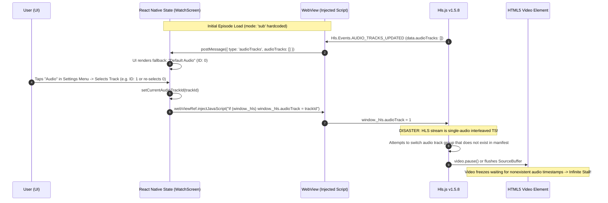

# Audio Track Lifecycle Snapshot: Birvana / AnimeVerse Mobile

## 1. Trace of the Complete Audio-Switching Path



---

## 2. Source Code of the Audio Pipeline

### A. Discovery and Message Dispatch in React Native (`src/app/watch/[id].tsx`)

```tsx
// 1. Audio Track Discovery from WebView
const [availableAudioTracks, setAvailableAudioTracks] = useState<AudioTrackInfo[]>([]);
const [currentAudioTrackId, setCurrentAudioTrackId] = useState<number>(0);

// Inside handleWebViewMessage:
if (data.type === 'audioTracks') {
  if (Array.isArray(data.audioTracks)) setAvailableAudioTracks(data.audioTracks);
  if (typeof data.currentTrack === 'number') setCurrentAudioTrackId(data.currentTrack);
}

// 2. Audio Track Selection Handler:
const handleSelectAudioTrack = useCallback(
  (trackId: number) => {
    setCurrentAudioTrackId(trackId);
    sendPlayerCommand(`
      if (window._hls) {
        window._hls.audioTrack = ${trackId};
      }
    `);
    const track = availableAudioTracks.find((t) => t.id === trackId);
    if (track) showBadge(`Audio: ${track.name || track.lang}`);
  },
  [sendPlayerCommand, availableAudioTracks, showBadge],
);
```

### B. Injected Script Inside WebView (`hianimeHtml`)

```javascript
hls.on(Hls.Events.AUDIO_TRACKS_UPDATED, function(event, data) {
  if (data.audioTracks && data.audioTracks.length > 0) {
    var tracks = data.audioTracks.map(function(t, idx) {
      return { id: idx, name: t.name || t.lang, lang: t.lang };
    });
    post('audioTracks', { audioTracks: tracks, currentTrack: hls.audioTrack });
  }
});
```

### C. Backend HiAnime Provider Reality (`stream-aggregator/src/services/hianime.js`)

```javascript
async function resolveStream({ title, romaji, season = 1, episode = 1, mode = 'sub' }) {
  const playMode = mode === 'dub' ? 'dub' : 'sub';

  if (playMode === 'dub') {
    try {
      streamData = await hianimeStream(targetEp.epId, 'dub');
    } catch (err) {
      streamData = await hianimeStream(targetEp.epId, 'sub');
    }
  } else {
    streamData = await hianimeStream(targetEp.epId, 'sub');
  }

  return {
    streamUrl: proxiedMaster,
    mode: activeMode,
    ...streamData,
  };
}
```

---

## 3. The Root Cause of Pauses and Stalls

### Flawed Assumption vs. Upstream Reality
* **The Assumption**: The previous implementation assumed that HiAnime's `.m3u8` playlist is a multi-track master playlist with HLS `#EXT-X-MEDIA:TYPE=AUDIO` track variants for Japanese, English, Hindi, etc., switchable on-the-fly via `window._hls.audioTrack = id`.
* **The Reality**:
  1. HiAnime serves **two completely independent streams**:
     * A Subtitled stream (`mode: 'sub'`) with Japanese stereo audio multiplexed into video segments.
     * A Dubbed stream (`mode: 'dub'`) with English audio multiplexed into separate video segments.
  2. The mobile app hardcodes `mode: 'sub'` in `api.resolveStream()`:
     ```tsx
     api.resolveStream({
       title: anime.title,
       season: currentSeason,
       episode: currentEp,
       mode: 'sub', // Hardcoded!
     })
     ```
     As a result, the mobile app **never requests the English Dub stream from the backend**.
  3. When the user opens the Audio menu in the mobile app, `availableAudioTracks` is either empty or contains a single track.
  4. When `handleSelectAudioTrack` injects `window._hls.audioTrack = trackId`, Hls.js attempts an internal audio-rendition switch. Because no alternate audio rendition exists in the HLS manifest, Hls.js detaches the audio SourceBuffer, waits for audio fragments that will never arrive, and halts video playback.

---

## 4. How the Working Website Solves Audio Switching

In `stream-aggregator/public/app.js`, the website does not attempt client-side HLS audio demuxing. Instead, it switches audio mode cleanly via the API while preserving the playback position:

```javascript
// 1. Language Toggle (SUB / DUB Buttons):
function onSelectAudioLang(lang) {
  if (lang === currentLang) return;

  // Capture current playback position before switching
  const currentPos = (activeVideo && activeVideo.currentTime > 1) ? activeVideo.currentTime : null;
  currentLang = lang;
  try {
    localStorage.setItem('animeverse_lang', currentLang);
  } catch {}

  // Request the new stream for this mode and resume at currentPos
  loadStream(currentPos);
}

// 2. Inside loadStream(targetResumeSec):
const res = await api(
  `/stream/resolve?title=${encodeURIComponent(a.title)}&season=${currentSeason}&episode=${currentEp}&mode=${currentLang}`
);

// 3. Initialize HLS with resume position:
const hls = new Hls({
  startPosition: targetResumeSec > 1.5 ? targetResumeSec : -1,
  // ...
});
```

### Necessary Architecture for Birvana Mobile
To support Sub and Dub without freezing or buffering:
1. Elevate `currentLang` ('sub' | 'dub') to first-class state in `WatchScreen`.
2. Pass `mode: currentLang` to `api.resolveStream`.
3. When the user changes audio language (SUB vs. DUB):
   * Capture `const currentPos = currentTime;`.
   * Switch `currentLang`.
   * Re-resolve the stream with `mode: nextLang`.
   * Load the new stream with `startPosition: currentPos` without unmounting the WebView container.
   * Resume uninterrupted playback seamlessly at `currentPos`.
